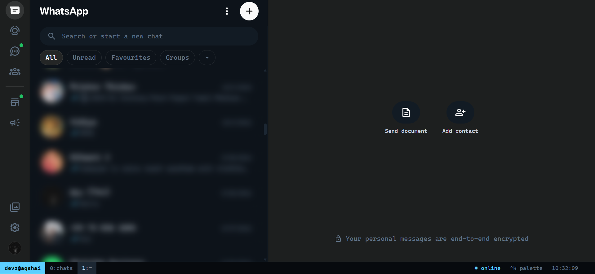
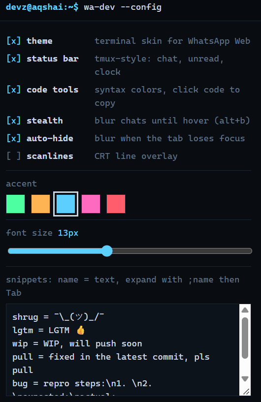
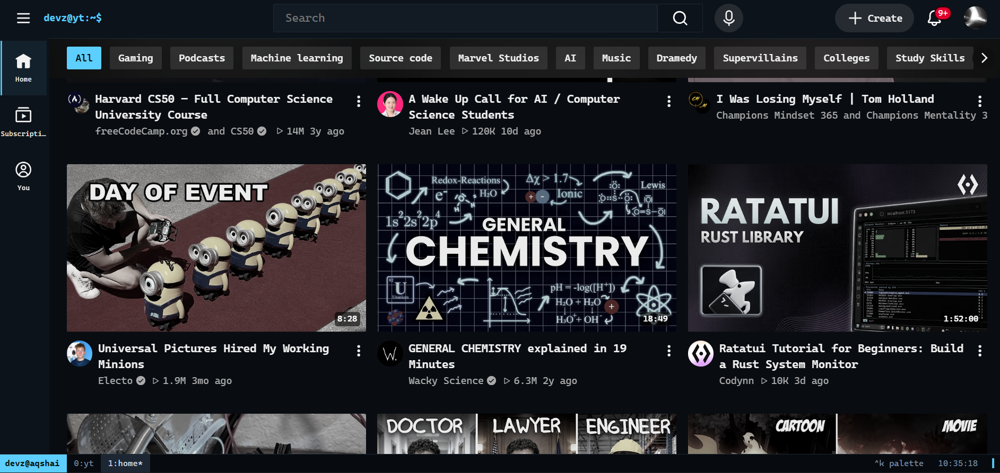
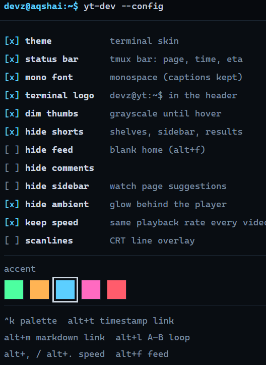
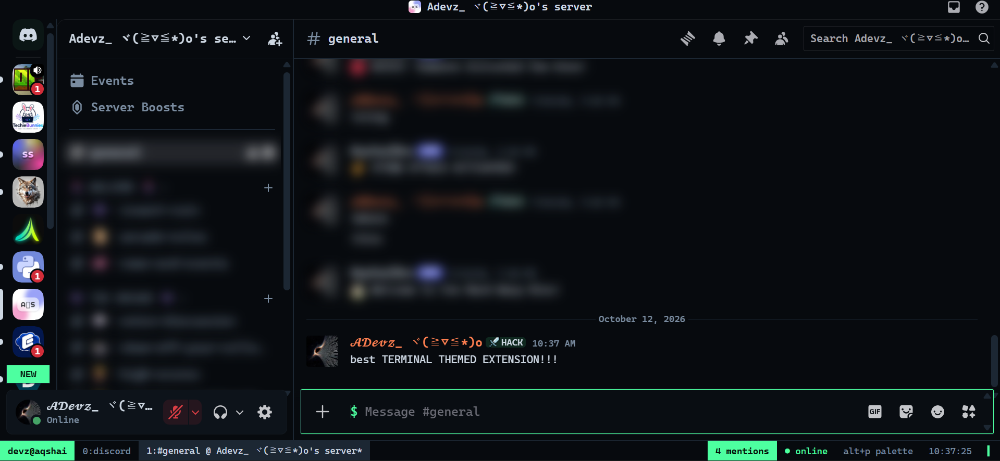
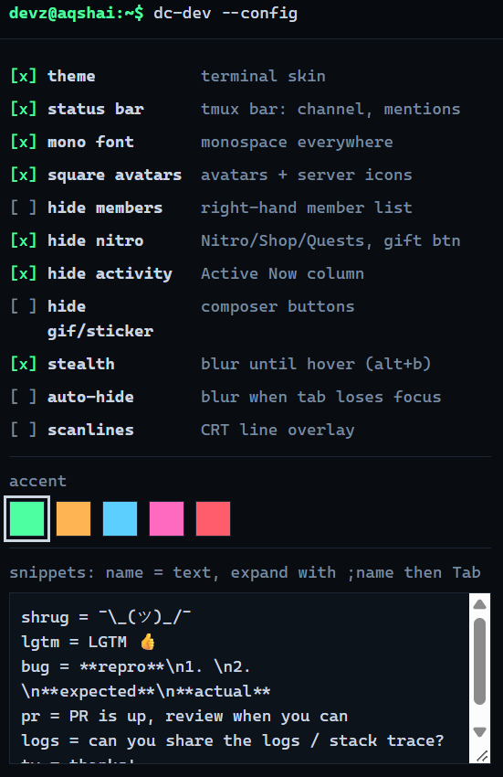

<div align="center">


```text
 ┌──────────────────────────────────────────────────┐
 │  devz@aqshai:~$ dev-skins --install whatsapp \   │
 │                            youtube discord       │
 └──────────────────────────────────────────────────┘
```

# DEV//SKINS

### Terminal-style skins for **WhatsApp Web**, **YouTube** and **Discord**

Three Chrome extensions. One hacker-clean design language. Built for developers.

<br>


<br>

[**Easy install**](#-easy-install-windows-no-coding) &nbsp;·&nbsp;
[**Manual install**](#-manual-install) &nbsp;·&nbsp;
[**Extensions**](#-the-collection) &nbsp;·&nbsp;
[**Theme**](#-the-theme) &nbsp;·&nbsp;
[**Make it yours**](#-make-it-yours) &nbsp;·&nbsp;
[**Troubleshooting**](#-troubleshooting)

</div>

<br>

> [!NOTE]
> Built by **Devz** (**AqshaiDev**), an independent developer who builds complete, deployable projects. Fork it, rename it, make it yours. **Not a developer?** On Windows, double-click `Customize-DevSkins.bat` and it does the customizing for you ([Easy install](#-easy-install-windows-no-coding)).


  <p align="center">
    
     
     <br><hr>
    
    
    <br><hr>
    
    
  </p>


---

## ✦ Preview

Every extension ships the same **tmux-style status bar** pinned to the bottom of the page. It is the signature of the whole set.

```text
WhatsApp  devz@aqshai │ 0:chats │ 1:Team Standup*                 3 unread  ● online  ^k palette  14:32:07 ▍
YouTube   devz@aqshai │ 0:yt    │ 1:watch/Rust in 100 Seconds*      A 1:20 B 1:45  1.5x  12:34/45:00 eta 21:47  ▍
Discord   devz@aqshai │ 0:discord │ 1:#general @ My Server*          2 mentions  ● online  alt+p palette  ▍
```

---

## ✦ The Collection

| Site | Extension | Runs on | Version | Folder |
|---|---|---|:-:|---|
|  | **wa-dev**, WhatsApp for developers | `web.whatsapp.com` | `1.0.0` | [`wa-dev/`](./wa-dev) |
|  | **yt-dev**, YouTube for developers | `www.youtube.com` | `1.0.0` | [`yt-dev/`](./yt-dev) |
|  | **dc-dev**, Discord for developers | `discord.com` (app, canary, ptb) | `1.0.1` | [`dc-dev/`](./dc-dev) |

Each folder is a **standalone** extension. Install one, two, or all three.

---

## ✦ Easy install (Windows, no coding)

Not a developer? Double-click **`Customize-DevSkins.bat`**, answer a few questions, and it builds **your own personalised copy** of the extensions, then walks you through loading them into your browser.

**1. Download** this repo: green **Code** button → **Download ZIP**

**2. Extract** it: right-click the ZIP → **Extract All…** (do not run the file from inside the ZIP)

**3. Double-click** `Customize-DevSkins.bat`

> [!NOTE]
> Windows may show **"Windows protected your PC"** because the file came from the internet. Click **More info → Run anyway**. The installer is a plain-text file, so you can open it in Notepad and read every line first.

**4. Answer the questions.** Press <kbd>Enter</kbd> on any question to keep the `[default]`.

| Step | It asks | What it changes |
|:-:|---|---|
| 1 | Which extensions you want | Which copies get built (WhatsApp, YouTube, Discord, or all) |
| 2 | Your name and a machine label | The `name@host` badge on every status bar and popup |
| 3 | Accent color: pick 1-5 or type a hex | The accent everywhere. Warns you if the color is too dark to read |
| 4 | Options for each extension | WhatsApp: font size · YouTube: logo text, hide Shorts, hide feed · Discord: hide members, hide Nitro |
| 5 | Where to save your copies | Default: `C:\Users\<you>\DevSkins` |
| 6 | Review and confirm | **Nothing is written until you say yes** |

**5. Load them into your browser, with your permission.** At the end the installer asks:

> *Walk me through installing now?*

Browsers do not let any script install an extension silently. Chrome removed the command-line shortcut for this in version 137 because malware abused it, and that is a good thing for your security. So the installer does the fiddly parts for you instead. **Only if you say yes**, it will:

- open your browser (Chrome, Edge or Brave, whichever it finds) on its **Extensions** page
- copy each extension's folder path to your clipboard, one at a time
- open the save folder in File Explorer

You then do three clicks per extension: turn on **Developer mode** (top-right) → **Load unpacked** → press <kbd>Ctrl</kbd> + <kbd>V</kbd> and **Select Folder**. Say no and it simply prints the same steps for later.

**Changing something later?** Run the file again. It remembers your last answers as the defaults and rebuilds your copies, then click **reload ↻** on each extension in `chrome://extensions`.

<details>
<summary><b>Safety: what the installer does and does not do</b></summary>

<br>

| It does | It does not |
|---|---|
| Copy the extension folders into the folder **you** choose | Change the original downloaded files |
| Edit text inside those copies (name, accent, defaults) | Need admin rights or ask for a password |
| Read the registry **only** to find where your browser is installed | Write to the registry or change any browser setting |
| Save your answers to `%USERPROFILE%\DevSkins\devskins-settings.json` | Use the internet or send anything anywhere |
| Refuse to touch a folder that is not one of its own earlier copies | Delete anything it did not create |

Your name and host are limited to letters, numbers, `-` and `_`, so a typo can never break the code it edits.

</details>

> [!TIP]
> Mac or Linux? Use the [manual install](#-manual-install) below. It takes two minutes.

---

## ✦ Manual install

> [!IMPORTANT]
> The repo root is **not** an extension. You load each extension **folder** (`wa-dev`, `yt-dev` or `dc-dev`) separately.

**1. Get the code**

```bash
git clone https://github.com/DEV-Aqshai/devz-skins.git 

cd devz-skins
```

No git? Click **Code → Download ZIP** on GitHub and unzip it.

**2. Load an extension**

1. Open `chrome://extensions`
2. Switch on **Developer mode** (top right)
3. Click **Load unpacked**
4. Select the folder, e.g. `devz-skins/wa-dev`
5. Open the site (or refresh it) and the skin appears

Repeat for the other folders. Pin the extension icons to your toolbar to reach the settings popup quickly.

**3. Updating**

`git pull`, then click the **reload ↻** icon on the extension's card in `chrome://extensions`, then refresh the tab.

<details>
<summary><b>Supported browsers</b></summary>

<br>

| Browser | Status |
|---|:-:|
| Google Chrome 111+ | ✅ |
| Microsoft Edge, Brave, Arc, Opera (Chromium) | ✅ |
| Firefox / Safari | ❌ not supported (Chrome Manifest V3 build) |

Chrome 111+ is needed for `color-mix()`, `:has()` and the CSS Custom Highlight API.

</details>

<details>
<summary><b>Recommended font</b></summary>

<br>

The extensions do **not** bundle a font. They use a monospace stack and fall back gracefully:

`JetBrains Mono → Fira Code → Cascadia Code → SF Mono → Menlo → Consolas → Noto Sans Tamil / Nirmala UI / Latha → monospace`

Install [JetBrains Mono](https://www.jetbrains.com/lp/mono/) locally for the intended look. Tamil script falls through to the Tamil fonts in the stack.

</details>

---

## ✦ The Theme

**Concept:** your chat apps and video feed, dressed like your editor and terminal. Dark ink-blue surfaces, one phosphor accent, square corners, monospace everywhere, and a status bar you would expect in tmux or vim.

### Palette

| Role | Swatch |
|---|:-:|
| Background |  |
| Panel |  |
| Raised |  |
| Line |  |
| Text |  |
| Dim (wa-dev) |  |
| Dim (yt-dev, dc-dev) |  |
| Deep (dc-dev, status bar) |  |

### Accent presets

Switch live from the popup or the command palette.

| Preset | Swatch |
|---|:-:|
| **green** (default) |  |
| amber |  |
| cyan |  |
| magenta |  |
| red |  |

### Syntax colors

Code blocks are colored the same way across WhatsApp and Discord:

| Token | Hex | Token | Hex |
|---|---|---|---|
| keyword | `#c792ea` | function | `#82aaff` |
| string | `#ecc48d` | type | `#7fdbca` |
| number | `#f78c6c` | comment | `#5f7184` |

### Shared design language

| Feature | WhatsApp | YouTube | Discord |
|---|:-:|:-:|:-:|
| Dark ink + phosphor accent | ✅ | ✅ | ✅ |
| Monospace font | ✅ | ✅ | ✅ |
| Square corners | ✅ | ✅ | ✅ |
| tmux-style status bar | ✅ | ✅ | ✅ |
| Command palette | ✅ `Ctrl+K` | ✅ `Ctrl+K` | ✅ `Alt+P` |
| Stealth blur (screen-share safe) | ✅ | n/a | ✅ |
| CRT scanlines (optional) | ✅ | ✅ | ✅ |
| Live accent switching | ✅ | ✅ | ✅ |

---

## ✦ wa-dev &nbsp; 

Turns WhatsApp Web into a terminal. Built for sending code, JSON and logs to teammates.

**Highlights**

- 🎨 Full terminal skin: dot-grid wallpaper, square bubbles with an accent bar, monospace type
- 🧩 **Syntax-colored code messages** using the CSS Custom Highlight API (no DOM edits). Click a code block to copy it
- ⌨️ **Command palette** with fuzzy search over commands, snippets and your visible chats
- ✂️ **Snippet expander:** type `;lgtm` then `Tab`
- 🕶️ **Stealth mode:** chats blur until hover, and optionally blur when the tab loses focus
- 📋 Copy the visible conversation as **markdown**

**Shortcuts**

| Keys | Action |
|---|---|
| <kbd>Ctrl</kbd> + <kbd>K</kbd> | Command palette |
| <kbd>Alt</kbd> + <kbd>C</kbd> | Wrap / unwrap composer text in a code block |
| <kbd>Alt</kbd> + <kbd>J</kbd> | Prettify JSON into a code block |
| <kbd>Alt</kbd> + <kbd>B</kbd> | Toggle stealth blur |
| `;name` + <kbd>Tab</kbd> | Expand a snippet |

<details>
<summary><b>Palette commands</b></summary>

<br>

| Group | Commands |
|---|---|
| composer | wrap in code block, prettify JSON, inline code, base64 encode/decode, URL encode/decode |
| insert | UUID v4, unix timestamp, ISO timestamp |
| chat | copy visible messages as markdown, search chats, jump to a visible chat |
| toggle | stealth, auto-hide, scanlines, status bar, code tools, theme |
| accent | green, amber, cyan, magenta, red |
| snippet | every snippet you define |

</details>

<details>
<summary><b>Settings (toolbar popup)</b></summary>

<br>

Theme · Status bar · Code tools · Stealth · Auto-hide · Scanlines · Accent · Font size (11–16px) · Snippet editor

</details>

---

## ✦ yt-dev &nbsp; 

YouTube for learning and focus. Strips the noise, adds the tools you want when you watch a tutorial.

**Highlights**

- 🎨 Terminal skin with your accent on the progress bar, scrubber and badges
- 🖥️ The YouTube logo becomes a prompt: `devz@yt:~$`
- 🌫️ **Dimmed thumbnails:** grayscale until you hover
- 🎯 **Focus toggles:** hide Shorts, home feed, comments, watch-page sidebar and ambient glow
- 🔁 **A-B loop** a section of a video until you get it
- 🔗 **Timestamp links** and markdown links, ready to paste into notes or docs
- 🐢 **Keep playback speed** across every video
- 📸 Save or copy the **current frame** as PNG

**Shortcuts**

| Keys | Action |
|---|---|
| <kbd>Ctrl</kbd> + <kbd>K</kbd> | Command palette (type `1:23` to jump to a time) |
| <kbd>Alt</kbd> + <kbd>T</kbd> | Copy link at the current time |
| <kbd>Alt</kbd> + <kbd>M</kbd> | Copy markdown link at the current time |
| <kbd>Alt</kbd> + <kbd>L</kbd> | A-B loop: set A, set B, clear |
| <kbd>Alt</kbd> + <kbd>,</kbd> / <kbd>Alt</kbd> + <kbd>.</kbd> | Slower / faster by 0.25x |
| <kbd>Alt</kbd> + <kbd>F</kbd> | Toggle the home feed (focus mode) |

<details>
<summary><b>Palette commands</b></summary>

<br>

| Group | Commands |
|---|---|
| video | copy link / markdown link at current time, copy title, copy ID, A-B loop, loop video, save frame, copy frame, picture-in-picture |
| speed | 0.5x to 3x presets, faster, slower |
| toggle | Shorts, feed, comments, sidebar, ambient, dim thumbnails, keep speed, mono font, logo, status bar, scanlines, theme |
| go | home, subscriptions, history, watch later, liked videos, playlists |
| seek / search | type a time (`1:23`, `90s`) to jump, or any text to search YouTube |

</details>

<details>
<summary><b>Settings (toolbar popup)</b></summary>

<br>

Theme · Status bar · Mono font · Terminal logo · Dim thumbs · Hide Shorts · Hide feed · Hide comments · Hide sidebar · Hide ambient · Keep speed · Scanlines · Accent

</details>

---

## ✦ dc-dev &nbsp; 

Discord for the dev-community server. Code blocks, IDs and timestamps without leaving the keyboard.

**Highlights**

- 🎨 Terminal skin that overrides Discord's own theme variables, with `$ ` on the composer prompt
- 🧩 Recolored **highlight.js** code blocks, matching the rest of the set
- ⌨️ **Command palette on `Alt+P`** (`Ctrl+K` stays Discord's quick switcher)
- 🧱 **Code block with language:** js, ts, python, php, kotlin, java, bash, sql, json, html, css, go, rust, cpp, yaml, diff
- 🕒 **Discord timestamps:** insert `<t:…:R>` or turn a typed date into one
- 🆔 **Copy channel ID, server ID or channel link** (handy for bot developers)
- 🧹 Declutter: hide members, Nitro / Shop / Quests, Active Now, GIF and sticker buttons
- 🕶️ **Stealth blur** for screen sharing

> [!NOTE]
> Nothing in dc-dev sends messages or talks to Discord's API. Tools only fill the composer. You still press <kbd>Enter</kbd> yourself.

**Shortcuts**

| Keys | Action |
|---|---|
| <kbd>Alt</kbd> + <kbd>P</kbd> | Command palette |
| <kbd>Alt</kbd> + <kbd>C</kbd> | Wrap / unwrap composer text in a code block |
| <kbd>Alt</kbd> + <kbd>J</kbd> | Prettify JSON into a ` ```json ` block |
| <kbd>Alt</kbd> + <kbd>B</kbd> | Toggle stealth blur |
| `;name` + <kbd>Tab</kbd> | Expand a snippet |

<details>
<summary><b>Palette commands</b></summary>

<br>

| Group | Commands |
|---|---|
| composer | code block toggle, JSON prettify, inline code, quote lines, spoiler, base64, URL encode/decode, date text to Discord timestamp |
| code | code block with any of 16 languages |
| insert | UUID v4, unix / ISO timestamp, Discord timestamp (relative, full, time) |
| id | copy channel ID, server ID, channel link |
| chat | copy visible messages as markdown |
| toggle | stealth, auto-hide, members, Nitro, Active Now, GIF/sticker, square avatars, mono font, status bar, scanlines, theme |
| snippet / accent | your snippets and the five accent presets |

</details>

<details>
<summary><b>Settings (toolbar popup)</b></summary>

<br>

Theme · Status bar · Mono font · Square avatars · Hide members · Hide Nitro · Hide Active Now · Hide GIF/sticker · Stealth · Auto-hide · Scanlines · Accent · Snippet editor

</details>

---

## ✦ Make it yours

> [!TIP]
> **On Windows?** `Customize-DevSkins.bat` does steps 1, 2 and 4 below for you with a few questions. Read on if you want to do it by hand or go further.

### 1. Change my name to yours

The prompt `devz@aqshai` is the status-bar badge and popup header in all three extensions, and `devz@yt` is the YouTube logo text. There are **9** spots in total:

| File | What it controls |
|---|---|
| `wa-dev/content/content.js` | status-bar badge (`const USER`) |
| `wa-dev/popup/popup.html` | popup header |
| `yt-dev/content/content.js` | status-bar badge (`const USER`) |
| `yt-dev/content/theme.css` | YouTube logo text (`content: "devz@yt:~$"`) |
| `yt-dev/popup/popup.html` | popup header |
| `yt-dev/popup/popup.js` | setting label text |
| `yt-dev/shared/defaults.js` | code comment |
| `dc-dev/content/content.js` | status-bar badge (`const USER`) |
| `dc-dev/popup/popup.html` | popup header |

**Option A: one command** (macOS, Linux, or Git Bash on Windows). Run it from the repo root and replace `YOURNAME` and `YOURHOST`:

```bash
grep -rlE "devz@" . --include=*.js --include=*.html --include=*.css \
  | xargs sed -i.bak \
      -e 's/devz@aqshai/YOURNAME@YOURHOST/g' \
      -e 's/devz@yt/YOURNAME@yt/g'
find . -name "*.bak" -delete
```

**Option B: any editor.** In VS Code press <kbd>Ctrl</kbd> + <kbd>Shift</kbd> + <kbd>H</kbd> (Find in Files) and replace:

1. `devz@aqshai` → `YOURNAME@YOURHOST`
2. `devz@yt` → `YOURNAME@yt`

Then click **reload ↻** on each extension in `chrome://extensions`.

> [!TIP]
> Windows PowerShell can corrupt the emoji and special characters in the snippet defaults when saving files. Prefer Option A (Git Bash) or Option B.

### 2. Change the accent color

**Easy way:** open the extension popup and pick a swatch. It applies instantly and syncs across your Chrome profile.

**Add your own preset or change the default:** edit `shared/defaults.js` in each extension.

```js
// wa-dev/shared/defaults.js  (yt-dev: YD_ACCENTS · dc-dev: DD_ACCENTS)
window.WA_DEV_ACCENTS = {
  green: '#4dffa0',
  amber: '#ffb454',
  purple: '#b48cff',   // <- your new preset appears in the popup and palette
};

// and the default shown on first run
accent: '#4dffa0',
```

### 3. Change the whole palette or font

Each theme starts with a block of CSS variables. Change them and reload.

| Extension | File | Variable prefix |
|---|---|---|
| wa-dev | `wa-dev/content/theme.css` | `--dz-*` |
| yt-dev | `yt-dev/content/theme.css` | `--yd-*` |
| dc-dev | `dc-dev/content/theme.css` | `--dd-*` |

```css
:root {
  --dd-bg:    #090d12;   /* page background  */
  --dd-panel: #0d131a;   /* sidebars, menus  */
  --dd-raise: #121b24;   /* inputs, bubbles  */
  --dd-line:  #1c2733;   /* borders          */
  --dd-text:  #cdd7e2;
  --dd-dim:   #7a8ca0;
  --dd-font:  "JetBrains Mono", "Fira Code", monospace;
}
```

### 4. Edit snippets and defaults

- **Snippets** (wa-dev, dc-dev): edit them live in the popup, one per line as `name = text`. Use `\n` for a new line. Type `;name` then <kbd>Tab</kbd> in the composer.
- **Default toggles** for a fresh install: change the `true` / `false` values in each `shared/defaults.js`.

---

## ✦ Project structure

```text
dev-skins/
├── README.md
├── LICENSE
├── Customize-DevSkins.bat     ← Windows guided installer (asks questions, edits copies)
├── wa-dev/                    ← WhatsApp Web
│   ├── manifest.json
│   ├── content/
│   │   ├── theme.css          skin + status bar + palette styles
│   │   ├── early.js           applies theme before first paint (no flash)
│   │   └── content.js         status bar, palette, snippets, code tools
│   ├── popup/                 settings UI (html / css / js)
│   ├── shared/defaults.js     default settings + accent presets
│   └── icons/
├── yt-dev/                    ← YouTube
│   ├── manifest.json
│   ├── content/               theme.css · early.js · content.js
│   ├── shared/                defaults.js · apply.js
│   ├── popup/
│   └── icons/
└── dc-dev/                    ← Discord
    ├── manifest.json
    ├── content/               theme.css · early.js · content.js
    ├── shared/                defaults.js · apply.js
    ├── popup/
    └── icons/
```

---

## ✦ How it works

<details>
<summary><b>Technical notes</b></summary>

<br>

**Skinning without fighting the sites.** Each site is themed through the variables it already uses, then patched with structural selectors where needed.

| Site | Hooks used |
|---|---|
| WhatsApp Web | its CSS variables (`--app-background`, `--incoming-background`, …), `#side`, `#main`, `.message-in`, `.message-out`, `[data-pre-plain-text]` |
| YouTube | `--yt-spec-*` design tokens, `html[dark]`, `ytd-*` custom elements, player classes such as `.ytp-play-progress` |
| Discord | `--background-*`, `--text-*`, `--header-*` variables (plus the newer `--background-base-*` set), Discord's `hljs-*` classes, `li[id^="chat-messages-"]`, partial class matches like `[class*="chatContent"]` |

**No flash on load.** `early.js` runs at `document_start` and sets the theme before the page paints.

**Robust to page rewrites.** Discord rewrites `<html class>` from time to time, which used to flash the stock UI. `dc-dev` (v1.0.1+) therefore keeps its skin flags in a `data-dd` attribute instead of CSS classes, and a `MutationObserver` restores them instantly if the page touches `<html>`. `wa-dev` and `yt-dev` still use classes with a polling fallback. If you ever see the same flash there, the `dc-dev` approach (`shared/apply.js` and the `[data-dd~="…"]` selectors in `theme.css`) is the template to copy.

**Code highlighting without touching the page.** wa-dev uses the CSS Custom Highlight API, so it never edits WhatsApp's DOM and cannot break React.

**Safe DOM building.** All UI is built with `createElement` and `textContent`. No `innerHTML`, so it also works on sites that enforce Trusted Types.

</details>

---

## ✦ Privacy & permissions

| | wa-dev | yt-dev | dc-dev |
|---|:-:|:-:|:-:|
| `storage` (saves your settings) | ✅ | ✅ | ✅ |
| Site access | `web.whatsapp.com` | `www.youtube.com` | `discord.com` app pages |
| Network requests | none | none | none |
| Analytics / tracking | none | none | none |
| Reads your messages | only when you run "copy as markdown" | n/a | only when you run "copy as markdown" |

Settings are stored with `chrome.storage.sync`, so they follow your signed-in Chrome profile. Nothing leaves your browser except through Chrome's own sync.

---

## ✦ Troubleshooting

<details>
<summary><b>Installer: "Windows protected your PC" or antivirus warning</b></summary>

<br>

Windows flags every `.bat` file downloaded from the internet. Click **More info → Run anyway**. If your antivirus quarantines it, that is a false positive common to all batch scripts. You can read the whole file in Notepad, or skip it and use the [manual install](#-manual-install).

</details>

<details>
<summary><b>Installer: the window opens and closes instantly, or says it cannot find the folders</b></summary>

<br>

You most likely ran it from **inside** the ZIP. Extract the ZIP first (right-click → **Extract All…**), open the extracted folder, and run `Customize-DevSkins.bat` from there. The `wa-dev`, `yt-dev` and `dc-dev` folders must sit next to it.

</details>

<details>
<summary><b>"Developer mode" is greyed out or missing</b></summary>

<br>

Your browser is managed by an organization (work or school) that blocks unpacked extensions. That is a policy on your side, and no installer can bypass it. Use a personal browser profile.

</details>

<details>
<summary><b>The extension shows an error after I moved or deleted the DevSkins folder</b></summary>

<br>

Your browser loads unpacked extensions directly from the folder, so it has to stay where it was. Run `Customize-DevSkins.bat` again to rebuild it, then load it with **Load unpacked** (or click **reload ↻** if it is still listed).

</details>

<details>
<summary><b>The page looks stock, or only partly themed</b></summary>

<br>

1. Make sure you loaded the extension **folder**, not the repo root
2. Click **reload ↻** on the extension card, then refresh the tab
3. Check the toolbar popup: **Theme** must be on
4. Sites rename internal CSS classes without notice. If one area looks wrong after a site update, open an issue with a screenshot and which area it was

</details>

<details>
<summary><b>Discord: the UI flashes back to normal</b></summary>

<br>

Fixed in `dc-dev` v1.0.1. If you still see it, open DevTools → Console → enable the **Verbose** level and look for lines starting with `[dc-dev]`. Include them in your issue.

</details>

<details>
<summary><b>Discord: Ctrl+K opens Discord's switcher, not the palette</b></summary>

<br>

That is intentional. dc-dev uses <kbd>Alt</kbd> + <kbd>P</kbd> so it never steals Discord's own shortcut.

</details>

<details>
<summary><b>Snippets do not expand</b></summary>

<br>

Type the snippet at the **end** of your text (`;name` with the cursor right after it), then press <kbd>Tab</kbd>. Names may contain letters, numbers, `_` and `-`.

</details>

<details>
<summary><b>Some buttons are not hidden (Nitro, gift, Shorts)</b></summary>

<br>

A few hide rules match English labels, such as `aria-label="Send a gift"` and the YouTube "Shorts" sidebar entry. They will not match a non-English interface.

</details>

<details>
<summary><b>Mac: Alt shortcuts type special characters</b></summary>

<br>

Use <kbd>Option</kbd> in place of <kbd>Alt</kbd>. The extensions read the physical key, so the shortcuts still fire. On Mac, <kbd>⌘</kbd> + <kbd>K</kbd> opens the palette in wa-dev and yt-dev.

</details>

---

## ✦ Known limitations

- These skins depend on third-party websites whose markup changes. Expect occasional selector fixes.
- English-only labels for a few hide rules (see Troubleshooting).
- Chromium browsers only.
- WhatsApp's message editor and Discord's composer are rich-text editors. Composer tools use a synthetic paste with a fallback, and may need a tweak if either site changes its editor.

---

## ✦ Disclaimer

> [!WARNING]
> **Unofficial.** This project is not affiliated with, endorsed by, or sponsored by WhatsApp, Meta, Google, YouTube, Discord or Anthropic. All product names and logos are trademarks of their owners.
>
> The Windows installer is a plain-text script. As with any script you download, read it before you run it.
>
> These are client-side visual and convenience tools. They make no network requests and never send messages or automate actions for you. Modifying a website's appearance may still conflict with a platform's terms of service, so **use at your own risk**.

---

## ✦ License

Released under the [MIT License](./LICENSE). Copyright © 2026 Devz (AqshaiDev).

---

<div align="center">

**Built by Devz · AqshaiDev**

`devz@aqshai:~$ █`

</div>
